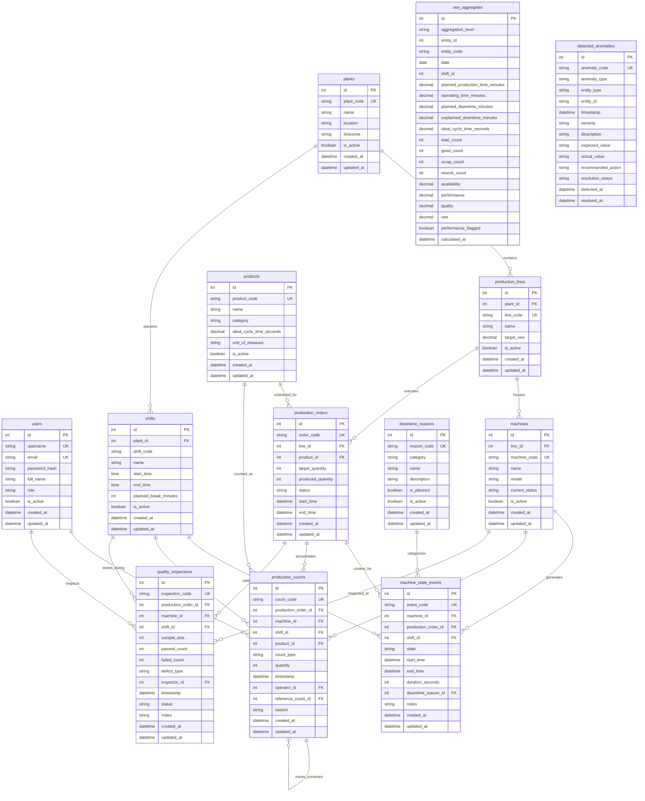

# FactoryPulse — Entity-Relationship Diagram (ERD)

This document visualizes the complete normalized relational schema for **FactoryPulse**, representing plant hierarchies, production execution, machine states, quality inspections, downtime tracking, and OEE aggregation.

